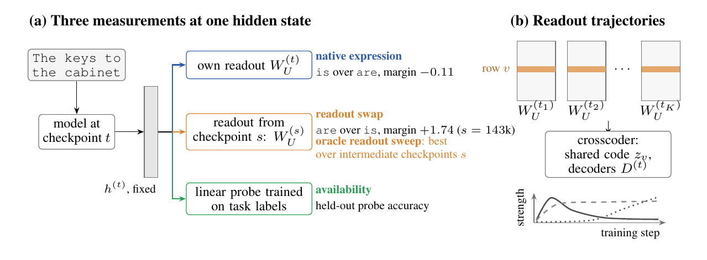

# Learning to Read Out: Unembedding Dynamics in Language Model Pretraining

[](#citation)
[](https://arxiv.org/abs/2610.21025)
[](https://openreview.net/forum?id=FlkhJrDVyI)
[](https://huggingface.co/hematteo)
[](LICENSE)
[](https://github.com/hematteo/learning-to-read-out/actions/workflows/ci.yml)

This repository is the official implementation of **Learning to Read Out:
Unembedding Dynamics in Language Model Pretraining** (NeurIPS 2026), by Matteo
He, William F. Shen, Alex Iacob, Andrej Jovanovic, Xinchi Qiu, and Nicholas D.
Lane.

[arXiv](https://arxiv.org/abs/2610.21025) ·
[OpenReview](https://openreview.net/forum?id=FlkhJrDVyI) ·
[Project page](https://learning-to-read-out.pages.dev) ·
[Feature atlas](https://learning-to-read-out.pages.dev/atlas/)

<p align="center">
  
</p>

Whether a model predicts the right token depends on two learned components: the
final hidden state and the unembedding matrix `W_U` (the *readout*) that maps it to
logits. We show that hidden states can encode a task distinction, such as subject
number in subject–verb agreement, before the model's own readout natively expresses
it. A distinction is **available** once a linear probe can decode it from the
hidden state, and **natively expressed** once the model's own readout prefers the
correct answer. To track the readout directly we introduce
**parameter-trajectory crosscoding**, which fits one sparse dictionary to the
trajectory every vocabulary row of `W_U` traces across checkpoints. We combine it
with readout swaps (decoding one checkpoint's hidden state with another
checkpoint's readout) and probes on fixed hidden states, on Pythia (160M to 6.9B)
and OLMo-2-7B, and in controlled 31M pretraining runs that vary only the readout's
learning rate.

## Core algorithms

| Method in the paper | Code |
|---|---|
| Parameter-trajectory crosscoding: one sparse dictionary over every readout row's trajectory | `readout.crosscoder`: `load_snapshots`, `preprocess_snapshots`, `train`, `quick_quality`; encoding and reconstruction in `readout.crosscoder.inference` |
| Readout swap and contrast margin | `readout.probes.readout_swap`: `compute_margin`, `evaluate_swap_cell`, `align_readout` (mean, scale, row norm, or orthogonal Procrustes alignment) |
| Availability, native expression, best swept readout | `readout.probes.availability_expression`: `availability_probe`, `native_and_best_swept` |
| Contrastive tasks (Table 1) | `readout.probes.contrastive_tasks` (`build_sva`, `build_ioi_role_balanced`, `build_numeric_greater_than`, ...) |
| Lifecycle profiles | `readout.dynamics.lifecycle`: `classify_profiles_refined`, `profile_fractions` |
| Reorganization score and window | `reproduce/lifecycle/find_reorganization_steps.py`, with change metrics from `readout.dynamics.metrics` |
| Sparse feature localization | `reproduce/localization/run_feature_attribution.py` |
| Readout learning rate control | `reproduce/recipe_control/train_control.py` (`--readout-lr-mult`) |

Fitting Pythia-160M's trajectory crosscoder with the paper's settings
(`configs/runs/pythia-160m_wu_d24576_seed0.yaml`; a GPU is advisable):

```python
from readout.crosscoder import load_snapshots, preprocess_snapshots, quick_quality, train

W, steps = load_snapshots("EleutherAI/pythia-160m")  # (32, V, d_model): W_U at 32 checkpoints
x, _ = preprocess_snapshots(W, mode="center_scale")   # center and scale each checkpoint's rows
crosscoder = train(
    x, expansion_factor=32.0, lr=5e-5, l1_coefficient=0.3, tanh_stretch_coefficient=1.0,
    l1_warmup_fraction=0.05, use_sparse_adam=False, n_epochs=300, batch_size=1024, seed=0,
)
print(quick_quality(crosscoder, x))  # explained variance, mean L0, dead rate
```

Scoring the same hidden states with two checkpoints' readouts:

```python
from readout.probes.readout_swap import compute_margin

native = compute_margin(h_t, W_U_t, y_plus, y_minus)   # (N,) margin under checkpoint t's own readout
swapped = compute_margin(h_t, W_U_s, y_plus, y_minus)  # same hidden states, readout of checkpoint s
```

The settings of record for every dictionary in the paper are in
[`configs/runs/`](configs/runs/), and `scripts/train/train_crosscoder.py` trains
from them.

## Installation

Python 3.11 or 3.12, with the environment managed by [`uv`](https://docs.astral.sh/uv/):

```bash
git clone https://github.com/hematteo/learning-to-read-out.git
cd learning-to-read-out
make install   # uv sync --extra dev --extra figures
```

The tests, examples, notebooks, and figure scripts run on CPU on Linux, macOS, and
Windows. Training dictionaries above 160M parameters and the 31M pretraining runs
target Linux with CUDA 11.8 (torch is pinned to the cu118 wheels on Linux). Device
selection is automatic (CUDA, then MPS, then CPU). Large inputs and outputs live under
`UM_SSD_ROOT` (default `./local_snapshots`).

## Quickstart

```bash
make test                                     # test suite, CPU only, no data
uv run python examples/minimal_crosscoder.py  # seeded crosscoder fit on a synthetic W_U stack, seconds
make figures                                  # redraw the paper's figures into paper_figures/out/
```

The example prints `FINAL  EV: untrained=... -> trained=...`; explained variance
rises from about 0 to about 0.8. Two Colab notebooks run the core analyses on
public Pythia checkpoints:

| Notebook | What it shows |
|---|---|
| [`01_availability_expression_lag.ipynb`](notebooks/01_availability_expression_lag.ipynb) [](https://colab.research.google.com/github/hematteo/learning-to-read-out/blob/main/notebooks/01_availability_expression_lag.ipynb) | Readout swaps on Pythia-160M: the same hidden states scored by their own and by later readouts |
| [`02_wu_trajectory_crosscoders.ipynb`](notebooks/02_wu_trajectory_crosscoders.ipynb) [](https://colab.research.google.com/github/hematteo/learning-to-read-out/blob/main/notebooks/02_wu_trajectory_crosscoders.ipynb) | A trajectory crosscoder on a toy and on real Pythia-160M snapshots, with feature lifecycles |

To run them locally: `uv run --extra figures --with jupyterlab jupyter lab notebooks/`.

## Released dictionaries and checkpoints

| Repository | Contents |
|---|---|
| [`hematteo/parameter-trajectory-crosscoders`](https://huggingface.co/hematteo/parameter-trajectory-crosscoders) | Trained trajectory crosscoders (Pythia-160M, 1B, 6.9B; OLMo-2-7B) with training sidecars, aggregates, activation rates, attribution artifacts, and held-out evaluation tokens |
| [`hematteo/readout-recipe-control`](https://huggingface.co/hematteo/readout-recipe-control) | The controlled 31M pretraining runs (readout learning rate 0.25×, 1×, 4×, and a shorter warmup; also a long-warmup run the paper leaves out of the comparison) |
| [`datasets/hematteo/wu-crosscoder-snapshots`](https://huggingface.co/datasets/hematteo/wu-crosscoder-snapshots) | Pre-extracted `W_U` snapshot stacks |

```bash
hf download hematteo/parameter-trajectory-crosscoders \
    --revision fb7ee860b9257f125ddbac7ff3c793b35fdcce8d \
    --local-dir "$UM_SSD_ROOT/hf_release/parameter-trajectory-crosscoders"
```

## Reproducing the paper

[`docs/REPRODUCE.md`](docs/REPRODUCE.md) is the single reproduction guide. It covers
three levels:

1. **Redraw the figures** with `make figures` (CPU, about 30 s) from the 4.9 MB of
   data in [`paper_figures/data/`](paper_figures/data/README.md). This covers
   Figures 2 to 5 and seven appendix figures (C.1, C.3, C.6, D.1, G.2, G.3, H.1).
2. **Recompute that data** from the released dictionaries and checkpoints with the
   analysis scripts in `reproduce/`, one folder per paper section.
3. **Retrain** the dictionaries (`scripts/train/train_crosscoder.py`) or the 31M runs.

For each paper result it gives the commands in order, the inputs and outputs, and
the known deviations from the paper's runs.

## Results

| Finding | Result |
|---|---|
| The dictionaries reconstruct the readout | Explained variance 0.808–0.920 across Pythia-160M, 1B, 6.9B and OLMo-2-7B; 1.17–2.26% of features active per row and checkpoint; no dead features |
| The readout reorganizes early | The reorganization score peaks between steps 512 and 1.6k in all three Pythia models (0.4–1.1% of training); p = 0.005 at 160M and 1B, p = 0.04 at 6.9B against circular-shift nulls; 20 of 21 Pythia dictionary fits select the same window |
| Lexical structure emerges before and during that window | In Pythia-160M, all 35 WordNet categories become decodable from the readout rows by step 1000, when all 35 also exceed the matched-random and shuffled-label nulls; median balanced accuracy rises from 0.499 at initialization to 0.874 at the final checkpoint |
| Hidden states encode subject number before the readout expresses it | On Pythia-6.9B subject–verb agreement, a linear probe nears ceiling by step 512 while native expression and the best swept intermediate readout are still at chance; across a subject relative clause, native accuracy is 0.75 at the final checkpoint with the probe at ceiling |
| Eight features carry the agreement margin | Decoding Pythia-1B step-1000 states with the reconstructed final readout, ablating the 8 top-attribution features lowers SVA accuracy from 0.900 to 0.487, keeping only them gives 0.938, and ablating 8 matched random features leaves 0.931 |
| Readout learning rate shifts the timing | In 31M runs, raising the readout learning rate multiplier from 0.25× to 1× to 4× moves the median feature peak step from 128 to 64 to 32 in every fit, one checkpoint per fourfold increase; final validation losses agree within 0.06 nats |

## Repository layout

| Path | Contents |
|---|---|
| `src/readout/` | The `readout` package: `crosscoder/` (trajectory crosscoding), `probes/` (readout swaps, availability probes, tasks), `dynamics/` (lifecycle metrics), `core/` (data, paths, model specs) |
| `scripts/` | Command-line tools: `extract/` (snapshots, hidden states, firing rates) and `train/` (dictionaries) |
| `reproduce/` | Analysis scripts behind each paper result, one folder per section: `validation/`, `lifecycle/`, `lexical/`, `availability/`, `localization/`, `readout_swaps/`, `recipe_control/` |
| `paper_figures/` | Scripts and data that redraw the paper's figures |
| `configs/runs/` | Settings of record for each published dictionary |
| `notebooks/`, `examples/` | Colab tours and a minimal example |
| `tests/` | CPU-only test suite |

CI runs `make test`, `make lint`, and `make figures`. Code shared across sections lives
in `src/readout/`; a script in `reproduce/` imports only `readout` and helpers in its own
folder. In file names,
`wu`/`we` mean `W_U`/`W_E`, `hln` the final hidden state after LayerNorm, `cc` a
crosscoder, and `persnap` the per-checkpoint SAE baseline.

## Third-party code

The crosscoder model and optimizer come from OpenMOSS
[Language-Model-SAEs](https://github.com/OpenMOSS/Language-Model-SAEs) (MIT), installed
from PyPI as `llamascopium==2.0.0b34`. `src/readout/crosscoder/_llamascopium_patch.py`
replaces one method, `Crosscoder.init_encoder_with_decoder_transpose`, with a version
that transposes each local shard, because the upstream version deadlocked in 4-GPU
head-parallel training; single-device behavior is unchanged. llamascopium declares
`torch>=2.11`, which has no CUDA 11.8 build, so `pyproject.toml` overrides that
requirement to keep Linux on torch 2.7.1+cu118, the version the paper's runs used.

A companion repository, [`sparse-readout-prism`](https://github.com/hematteo/sparse-readout-prism)
([arXiv:2609.01936](https://arxiv.org/abs/2609.01936)), factorizes a model's final
`W_U` into a sparse feature basis for logit-lens analysis.

## Citation

```bibtex
@inproceedings{he2026learningtoreadout,
  title     = {Learning to Read Out: Unembedding Dynamics in Language Model Pretraining},
  author    = {He, Matteo and Shen, William F. and Iacob, Alex and Jovanovic, Andrej
               and Qiu, Xinchi and Lane, Nicholas D.},
  booktitle = {Advances in Neural Information Processing Systems},
  year      = {2026},
  eprint    = {2610.21025},
  archivePrefix = {arXiv},
  primaryClass  = {cs.CL},
}
```

## License

MIT; see [`LICENSE`](LICENSE).
